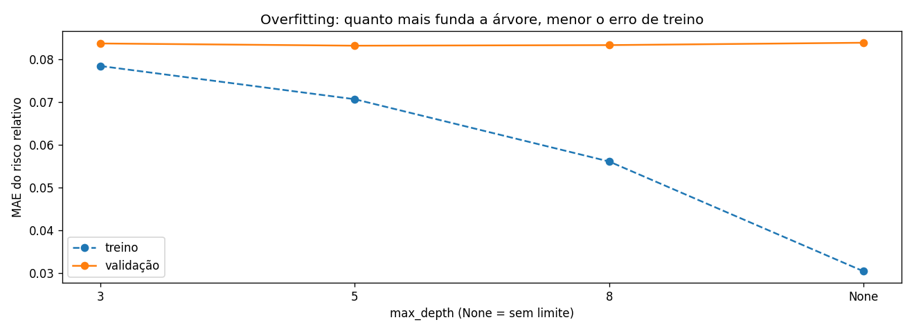
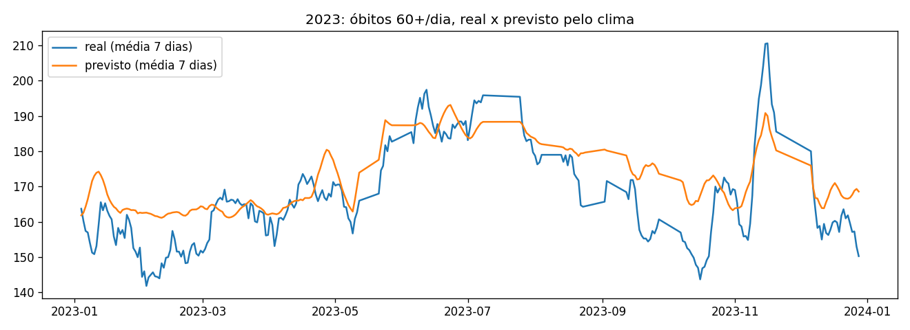
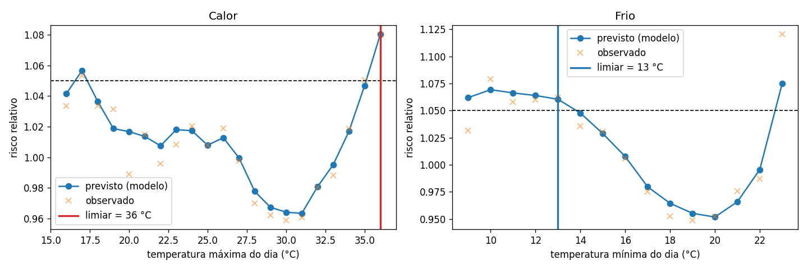

# Relatório de Machine Learning — Calor, frio e óbitos de idosos em São Paulo

**Projeto:** Termômetro do ACS (Global Solution CitizenTech, FIAP 2026)
**Integrante:** Luiz Henrique Dos Reis Grabe — RM 556001
**Notebook:** [`modelo_calor_obitos.ipynb`](modelo_calor_obitos.ipynb) · **Vídeo:** [link do YouTube]

## 1. Problema

Idosos são o grupo mais vulnerável a extremos de temperatura, e muitos moram em casas que esquentam ou esfriam mais que a rua. O Termômetro do ACS mede a temperatura **dentro** dessas casas com um ESP32 e prioriza as visitas do agente comunitário de saúde (ACS).

Para isso, o sistema precisa saber **em que dias o clima da cidade, por si só, já é perigoso**. A pergunta do modelo é:

> Dado o clima externo do dia e dos 7 dias anteriores, quantos óbitos de pessoas com 60+ anos são esperados na cidade de São Paulo, em relação ao normal?

A resposta vira os **limiares de "dia de risco"** da API: em dia de calor ou de frio perigoso, o semáforo das casas monitoradas sobe de prioridade.

## 2. Dados (reais e públicos)

| Fonte | Conteúdo | Período |
|---|---|---|
| INMET — estação automática A701 (Mirante de Santana, SP) | temperatura, máx./mín. horárias, umidade, ponto de orvalho, chuva | 2014–2023 |
| SIM/DATASUS — declarações de óbito (UF SP) | data do óbito, idade, município de residência, causa básica | 2014–2023 |

**Preparação** (`baixar_dados.py`):
- O INMET é horário e em UTC. Convertemos para o horário de Brasília (UTC-3) e agregamos por dia: máxima, mínima, média, umidade e chuva. Dias com menos de 18 horas válidas ficam sem valor (29 dias no período).
- Do SIM, filtramos os residentes da capital (`CODMUNRES` 355030) com 60 anos ou mais e contamos os óbitos por dia. São 3.652 dias, sem nenhuma lacuna, com média de ~167 óbitos por dia em 2023.

Detalhes das fontes e de como reproduzir: [`dados/README.md`](dados/README.md).

## 3. Preparação para o modelo

**COVID-19.** A pandemia criou um excesso de mortes que não tem relação com o clima. Comparamos cada mês com o esperado (média de 2014–2019 por mês, corrigida pela tendência). Saíram do treino 2020, 2021 e os meses de 2022 com mais de 10% de excesso: **janeiro (+49%) e fevereiro (+22%)**, na onda da Ômicron. O resto de 2022 ficou dentro do normal e foi usado.

**Tendência → risco relativo.** O número de óbitos de 60+ cresce cerca de 4 por dia a cada ano, com o envelhecimento da população. Modelos de árvore não extrapolam tendências. Por isso, ajustamos uma reta só com os anos de treino e usamos como alvo o **risco relativo (RR) = óbitos do dia ÷ esperado para o ano**. Um RR de 1,05 significa 5% acima do normal.

**Variáveis (32).** Para máxima, mínima e média, usamos os valores do dia e de cada um dos 7 dias anteriores (o calor age rápido e o frio demora mais). Também entram as médias móveis de 4 e 8 dias, a amplitude térmica, a umidade, o ponto de orvalho, a chuva e o dia da semana. Mês e dia do ano ficaram de fora **de propósito**, para que o modelo explique os óbitos pelo clima e não pelo calendário.

**Divisão.**
- **Treino:** 2014–2019 + março a dezembro de 2022 (2.453 dias).
- **Teste:** 2023 (285 dias). O modelo nunca viu esse ano.
- Sem embaralhar, porque em séries temporais embaralhar deixaria o modelo "ver o futuro".
- Os dias com alguma variável faltando (por causa dos lags de dias sem dado do INMET) ficaram de fora.

## 4. Modelo escolhido: Random Forest

A relação entre temperatura e mortalidade tem forma de **"U"**: sobe no frio e no calor. Uma regressão linear desenha uma reta e não captura isso. A Random Forest faz a média de muitas árvores de decisão treinadas em amostras diferentes, então captura curvas e interações (calor + umidade, frio de vários dias) sem precisarmos escrever a fórmula. A média também reduz o overfitting de uma árvore sozinha. O resultado é uma regressão, porque o alvo é um número contínuo (o RR).

## 5. Treino com hiperparâmetros diferentes

Usamos `GridSearchCV` com **24 combinações de 3 hiperparâmetros**:

| Hiperparâmetro | Valores | O que controla |
|---|---|---|
| `max_depth` | 3, 5, 8, sem limite | quanto cada árvore pode detalhar |
| `n_estimators` | 100, 300 | quantas árvores |
| `max_features` | 0,3; 0,6; 1,0 | fração das variáveis que cada divisão olha |

A validação cruzada usou **`TimeSeriesSplit` (5 dobras) só no treino**: cada dobra treina no passado e valida no período seguinte. Esse é o equivalente temporal do `StratifiedKFold` visto em aula. A métrica é o MAE do RR.

| `max_depth` | MAE treino (média) | MAE validação (média) |
|---|---|---|
| 3 | 0,078 | 0,084 |
| **5** | **0,071** | **0,083** |
| 8 | 0,056 | 0,083 |
| sem limite | 0,031 | 0,084 |

**Overfitting.** Sem limite de profundidade, o erro de treino cai para menos da metade, mas o de validação não melhora: as árvores **decoraram** o ruído dos dias de treino. A combinação vencedora foi `max_depth=5`, `max_features=0,3` e `n_estimators=300`, em que o erro de treino e o de validação ficam próximos. Tabela completa: [`resultados/busca_hiperparametros.csv`](resultados/busca_hiperparametros.csv).

## 6. Resultados: treino x teste

| Métrica | Treino | Teste 2023 | Referência no teste (RR = 1 sempre) |
|---|---|---|---|
| MAE (RR) | 0,075 | 0,074 | 0,099 |
| RMSE (RR) | 0,094 | 0,092 | 0,119 |
| R² | 0,40 | 0,29 | −0,19 |
| MAE (óbitos/dia) | 11,3 | 12,9 | 17,4 |

**Como interpretar:**
- **O modelo supera a referência** ("todo dia é normal") em 2023: o erro cai de 17,4 para 12,9 óbitos/dia. O clima explica uma parte real da variação.
- **Treino e teste têm MAE quase iguais**, ou seja, não sobrou overfitting relevante. O R² cai de 0,40 para 0,29, o que é esperado em um ano novo.
- **O erro está perto do piso.** Com ~167 óbitos/dia, só o acaso já faz o número variar cerca de ±13 de um dia para o outro. Um R² moderado era esperado: o clima é **uma** das causas de óbito, não a única.
- As variáveis mais importantes foram a **média de temperatura dos últimos 8 dias** e as **mínimas de 3 a 7 dias antes**: o efeito do frio é atrasado.

## 7. Curva de risco e limiares para o produto

Para cada faixa de 1 °C calculamos o RR médio previsto, usando só faixas com pelo menos 15 dias.

| Achado | Valor | Confiança |
|---|---|---|
| Máxima de menor risco | **31 °C** (RR 0,96) | alta |
| **Limiar de calor** (RR ≥ 1,05) | **máxima ≥ 36 °C** (RR 1,08; com 35 °C já chega a 1,05) | baixa: só ~22 dias por faixa |
| **Limiar de frio** (RR ≥ 1,05) | **mínima ≤ 13 °C** (RR 1,06; com 10 °C chega a 1,07) | alta: centenas de dias |
| Noites quentes | mínima de 23 °C: RR 1,08 previsto e 1,12 observado | baixa: 18 dias |

Os limiares vão para `resultados/limiares_ml.json`, que a API lê para marcar o "dia de risco".

## 8. Conclusão para o cidadão

Em São Paulo, **o frio pesa tanto quanto o calor** na mortalidade de idosos, e acontece em muito mais dias. Em dias com mínima de 13 °C ou menos, ou máxima de 36 °C ou mais, morrem cerca de 6 a 8% mais idosos que o normal na cidade. Noites que não esfriam também parecem perigosas.

Por isso, o semáforo do Termômetro do ACS ganhou um nível **azul (frio)**. Nesses dias, o agente de saúde visita primeiro as casas que o sensor mostra frias ou quentes demais. O modelo não diz **quem** vai adoecer: ele diz **quando** a cidade fica mais perigosa. Quem mostra **onde** é o sensor de cada casa.

## 9. Limitações e próximos passos

- **Estudo da cidade inteira (ecológico):** não serve para prever o risco individual.
- **Gripe:** o frio coincide com a temporada de vírus respiratórios, que não medimos. Parte do efeito do frio pode ser gripe.
- **Uma única estação:** o Mirante não representa as ilhas de calor da periferia.
- **Poucos dias extremos de calor:** o limiar de 36 °C deve ser revisto com mais anos de dados.
- **Dias faltando no teste:** 80 dias de 2023 saíram por falta de dado do INMET em algum lag. Um próximo passo é interpolar lacunas curtas.
- **Curva em parte no treino:** a curva usa dias de treino e de teste; ela descreve o padrão aprendido, não é uma medida independente.
- **Próximos passos:** usar várias estações, incluir dados de gripe (SIVEP) e recalcular os limiares todo ano.
